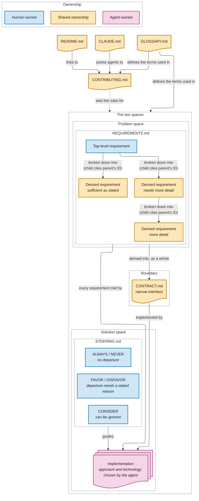

# Contributing

## Purpose of this file

_States that this file tells agents how to interact with this
repository when they contribute to it, and that it doesn't
cover how humans work with agents._

## Glossary

_One sentence pointing to [`GLOSSARY.md`](GLOSSARY.md), which
defines the terms this file uses._

## File layout and ownership

_A sentence on what the tree holds: only the files and
folders this file names that stay fixed as the
implementation grows, so nothing the implementation adds
goes in it. Then the tree: `README.md`, `CONTRIBUTING.md`,
`GLOSSARY.md`, `CLAUDE.md`, `REQUIREMENTS.md`,
`CONTRACT.md` and `STEERING.md` at the root, and
`.claude/hooks/save-transcript.sh`._

_A table of the major files and the implementation: what
each is for, and its ownership. `README.md`,
`CONTRIBUTING.md`, `GLOSSARY.md`, `CLAUDE.md` and
`CONTRACT.md` have shared ownership. `REQUIREMENTS.md` is
human-owned at its top level, with shared ownership below.
`STEERING.md` is human-owned. The implementation is
agent-owned; its row names no files or technology, and
doesn't call it "every other file"._

## Diagram

## The two spaces

_The split between the problem space and the solution space
is strict: requirements never specify or prescribe the
solution's tech stack, and steering never states a need. The
contract sits on the boundary between them._

## Problem space files

### Requirements (`REQUIREMENTS.md`)

_Holds the requirements, as a tree. The top level comes
entirely from the human. Every other requirement is derived
from the one above it and cites that parent's ID, so every
line traces back to the top. The human derives the lower
levels, with an agent's help if wanted, and decides what
goes in and understands every line. A requirement is broken
down only when it needs more detail: the levels aren't the
same content restated, and no bottom level captures
everything._

## Boundary files

### Contract (`CONTRACT.md`)

_Holds the contract: narrow, following the deep modules
principle, and derived from the requirements as a whole, at
every level. Agreed like a requirement._

## Solution space files

### Steering (`STEERING.md`)

_Holds the steering, written by the human. It's a bullet
list in which every bullet starts with a steering keyword:
`ALWAYS`, `NEVER`, `FAVOR`, `DISFAVOR` or `CONSIDER`. It
covers only what sits behind the contract, so it can't
contradict the contract._

#### Conflicts

_Why steering can't directly contradict a requirement, and
what a seeming contradiction means: something is in the
wrong file. `ALWAYS` and `NEVER` rules can still rule out
every implementation that meets the requirements._

### Implementation

_Agent-owned. It implements the contract and meets every
requirement, at every level. The agent chooses the approach
and technology from the requirements, the contract and the
steering; the human shapes it only through those three
files._

## Analogies

_One line: the analogies below are explicitly unrelated to
this repository and give no direction for it._

### A Python library

_The analogy applied to the whole structure, part by part.
The contract is the library's `.pyi` stub files: the public
signatures, and nothing about how they're implemented._

### A web service with an HTTP API

_The analogy applied to the whole structure, part by part.
The contract is the service's OpenAPI spec._

### A mobile app

_The analogy applied to the whole structure, part by part.
The contract is the screens and actions its users see._

## Traceability

_The overarching rule that every change to this repository
is traceable, through the audit trails below._

### Commits, issues and agent transcripts

_All work starts from an issue. Every commit message links
that issue and the transcript of the agent session that
made the commit. Every issue links the transcripts of the
sessions that drafted or changed it. Transcripts live on the
`agent-transcripts` branch, one file per session, which
`.claude/hooks/save-transcript.sh` updates after every
turn._
